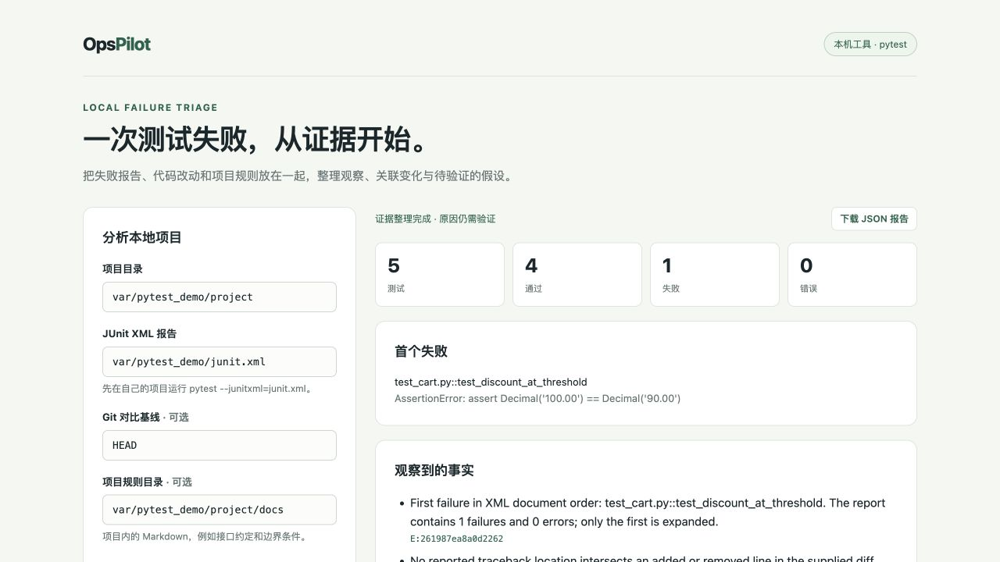

# OpsPilot

[](https://github.com/YGCYJA/opspilot/actions/workflows/ci.yml)
[](LICENSE)

**Local pytest failure analysis, with evidence you can inspect.**

OpsPilot 读取本地 pytest 的 JUnit XML，把失败用例、当前源码、相对指定 Git 基线的改动和可选项目规则放在同一份报告中，帮助确定下一步要检查什么。默认离线运行，不需要模型或 API Key。[完整中文说明](README.zh-CN.md)

OpsPilot turns a local pytest JUnit report into a compact debugging report. It brings together the failed assertion, nearby source, changes against an explicit Git baseline, and optional Markdown project notes. It separates observations from unverified explanations and suggests commands you can run to check them.

[Quick start](#quick-start) · [Architecture](docs/architecture.md) · [Configuration](docs/configuration.md) · [API](docs/api.md) · [Evaluation](docs/evaluation.md) · [Design choices](docs/design-decisions.md)

## A small, concrete use case

You change a shopping-cart function and one boundary test fails. The terminal tells you that `90.0` was expected but `100.0` was returned. OpsPilot collects the failed test, available source context, the changed comparison, and the note describing the discount boundary, so you can review them together.

It does not need to have seen the failure before. The current test result and source changes are the primary evidence. Retrieval is only used to find relevant rules in your own Markdown notes, such as “a discount applies when the subtotal is at least 100.”

Use it when several pieces of context are scattered between test output, source files, Git, and project notes. For a short traceback whose cause is already obvious, reading the traceback may be quicker.

## Quick start

Requires Python 3.11+ and Git. The default mode needs no GPU, downloaded weights, API key, or network model request.

```bash
git clone https://github.com/YGCYJA/opspilot.git
cd opspilot
python3 -m venv .venv
source .venv/bin/activate
python -m pip install -e '.[dev]'

# Generate a tiny repository and run real passing/failing pytest cases.
python scripts/reproduce_pytest_demo.py

# Read its failure evidence without running its code again.
opspilot triage \
  --repo var/pytest_demo/project \
  --junit var/pytest_demo/junit.xml \
  --base HEAD \
  --notes var/pytest_demo/project/docs \
  --output var/pytest_demo/report
```

On Windows, activate the environment with `.venv\Scripts\activate`. The demo needs pytest, included in the `dev` extra. It intentionally changes an inclusive discount boundary from `>= 100` to `> 100`, producing **one failed and four passed tests**. The generated repository's `HEAD` keeps the passing version. This is a constructed example, not a report from an external system.

The demo refuses to replace a non-empty output directory. To repeat it, choose another directory with `--output-dir var/pytest_demo_2` and update the analysis paths accordingly.

## Use it on your project

First run pytest yourself in the project you want to inspect:

```bash
cd /path/to/your/project
python -m pytest --junitxml=junit.xml
```

A test failure normally returns a non-zero exit code and still writes the XML. Then run the installed CLI:

```bash
opspilot triage \
  --repo /path/to/your/project \
  --junit /path/to/your/project/junit.xml \
  --base HEAD~1 \
  --notes /path/to/your/project/docs \
  --output /path/to/your/project/var/triage
```

Choose the baseline deliberately. `HEAD` compares the current working tree with the current commit; `HEAD~1` compares it with the previous commit. Omitting `--base` leaves out the Git comparison. Omitting `--notes` leaves out note retrieval; when supplied, the notes directory must be inside the analyzed repository. OpsPilot does not choose an “earlier successful build” automatically.

The output directory contains `report.json` and `report.md`. The report expands the first failure/error in XML document order and summarizes the other test outcomes. It shows the available source and change evidence, possible explanations to verify, and a suggested reproduction command. It does not automatically execute those commands or modify your project. Review a suggested command before running it in your own environment.

## Local web interface

```bash
python -m uvicorn opspilot.api:app --host 127.0.0.1 --port 8000
```

Open **http://127.0.0.1:8000** for the local form, or **http://127.0.0.1:8000/docs** for the HTTP API. Paths refer to files on the machine running OpsPilot. See the [API contract](docs/api.md).

The local page below shows the deliberately introduced cart regression described above:



## How it works

1. Parse failures and errors from the supplied JUnit XML.
2. Collect bounded source context from files inside the selected repository.
3. If requested, read changes against the explicit Git baseline and label their association with the reported location.
4. If requested, retrieve relevant passages from local Markdown rules.
5. Build a report with evidence references and unverified hypotheses.

The deterministic report is useful on its own. Optional model explanations must be read alongside their evidence; matching a quote does not prove that an explanation is correct. Use `--offline` to force the deterministic report even when model environment variables are set. See [configuration](docs/configuration.md) for the supported optional setup and [architecture](docs/architecture.md) for the boundaries.

## Development and validation

```bash
python -m pytest -q
python scripts/reproduce_pytest_demo.py --output-dir var/demo_check
opspilot triage --repo var/demo_check/project \
  --junit var/demo_check/junit.xml --base HEAD \
  --notes var/demo_check/project/docs --output var/demo_check/report
python -m pip install build
python -m build
```

Tests cover input validation, XML parsing, Git and path boundaries, evidence handling, report generation, and model failure handling. The small demo checks that the pipeline can collect evidence for an actual pytest regression; it is not a measure of general debugging accuracy. [Evaluation](docs/evaluation.md) explains what the checks do and do not establish.

```text
opspilot/
├── opspilot/             # local analysis, retrieval, model adapters, API and CLI
├── scripts/              # reproducible example generator and optional downloads
├── tests/                # regression and integration checks
├── docs/                 # contracts, design choices and validation
├── .github/workflows/    # automated checks
├── Dockerfile
├── pyproject.toml
└── README.zh-CN.md
```

## Scope

This is a local tool for small Python projects using pytest JUnit output. It reads the files you select; it does not connect to GitHub Actions, clone repositories, monitor services, run arbitrary tests, fix code, or prove a root cause. Some test runners omit filenames or code frames; dynamic imports and unfamiliar XML conventions can leave source association incomplete. The initial workflow expands only the first failure/error, not every failed test. A report describes the files as they exist at analysis time; it cannot verify that they are exactly the revision that produced an older XML file.

Keep the HTTP service on loopback. It has access to local file paths and no authentication, so it is not suitable for public hosting. Source and test logs may contain sensitive information; inspect reports before sharing them or enabling an external model provider.

See [CONTRIBUTING.md](CONTRIBUTING.md) for changes and bug reports. Code and authored examples use the [MIT license](LICENSE); dependencies and separately downloaded models keep their own licenses.
