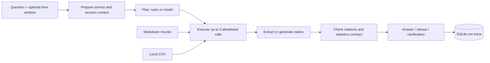

# Architecture

OpsPilot keeps retrieval, deterministic observations, and optional model generation visible in one bounded workflow.

## Retrieval

Markdown headings define sections; bounded line windows split sections into passages (default 480 characters, one overlapping line). Every passage retains its document ID and source lines. A hash of document, position, and text identifies the passage, so changed evidence receives a changed citation ID.

BM25 tokenizes English terms and Chinese character bigrams. Character TF-IDF uses trigrams. `hybrid` fuses their rankings using reciprocal rank fusion with constant 60; it is lexical fusion. `semantic` fuses BM25 with normalized local SentenceTransformer cosine ranking. The agent also applies a lexical coverage/BM25 admission heuristic, including in semantic mode; semantic ranking does not bypass that filter.

Indexes are built in memory at startup. The CLI `ingest` command exports JSON for inspection; the app does not load that exported index. This is intended for small corpora rather than a distributed search service.

## Planning and tools

The graph always follows `prepare → plan → execute → answer → verify`. It does not autonomously loop. Tool arguments are validated with Pydantic and extra arguments are rejected.

| Tool | Input | Output |
|---|---|---|
| `search_knowledge` | question string | up to 5 passages with ranking and source metadata |
| `analyze_service_logs` | allowlisted service, optional start/end | deterministic statistics and complete JSON observation |

The statistical intent rules recognize named services and common metric requests. Missing or ambiguous services produce `needs_clarification` without a model request. Session context can reuse the last service for explicit follow-ups such as “继续查询该服务”; it is not full conversational memory.

The model planner must include search and, for statistical tasks, the log tool. It cannot change the requested service or time bounds. Invalid plans fall back to rules and expose `mode=offline_fallback`. Proposed model calls remain in the trace when available. Tools never execute shell commands or modify a service.

## Answer contracts

Offline answers extract existing passages and include deterministic log observations. Model answers provide structured claims, each with a source ID and a continuous verbatim quote of at least six characters. Statistical model answers must preserve the complete log JSON observation; missing or altered values trigger fallback. Empty-window results cannot be rewritten as a zero error rate or healthy service.

| Field | Meaning |
|---|---|
| `status=answered` | the output passed the implemented evidence contract |
| `status=refused` | insufficient evidence or failed answer validation |
| `status=needs_clarification` | a statistical request needs one supported service |
| `mode=offline` | rule planning / extractive output, including clarification |
| `mode=llm` | model workflow completed without fallback |
| `mode=offline_fallback` | model workflow failed and deterministic behavior was used |

Both remote and local model adapters report workflow mode as `llm`; `model_backend` distinguishes `http` and `local_transformers`. If model generation fails, deterministic statistics can still be returned; without statistics the answer is refused and retrieval evidence remains available for inspection.

## Persistence and data flow

`Store` saves JSON runs in SQLite under the writable state directory. A run includes evidence, plans, tool timings, claims, status, warnings, and model usage. Local model runs also retain generation records. Model providers receive the question and retrieved evidence in opt-in HTTP mode. Review data before using external providers or sharing run traces.

## Boundaries

- Citation validation proves that a quoted span exists in the cited evidence. It does not prove that the claim follows from the quote or is factually correct.
- Intent detection and service selection use rules. The two services and accepted log provenance types are explicit constraints.
- No authentication, tenancy isolation, retention policy, production telemetry ingestion, or distributed task queue is included. SQLite is intended for local use.
- Redaction removes configured keys and common bearer/key patterns. It does not identify every secret or personal detail.
- Local small-model generation is experimental; structured output constraints can still lead to truncation or fallback.
- Retrieval and model evaluations use small authored fixtures. Their scores are not estimates of real-world reliability.
