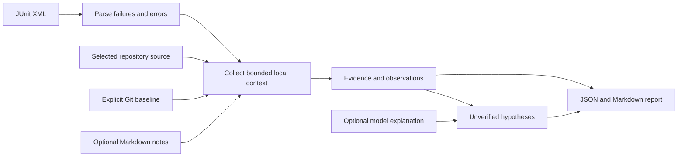

# Architecture

OpsPilot analyzes a local pytest failure without importing or executing the target project. The report combines deterministic observations with optional explanations.

## Inputs and collection

The user supplies the repository and XML paths. `base_ref` and `notes_dir` are optional. A baseline is a comparison target supplied by the user, not a claim that the chosen commit passed the tests. Analysis reads the current working tree; it does not check out the baseline or change files.

The parser counts test-case outcomes and expands the first failing or errored test case in XML document order, preserving its assertion or traceback as evidence. Skipped tests are not counted as passing tests. Source collection uses paths available in the test result and traceback. It only reads source that resolves inside the selected repository. Missing paths or unfamiliar traceback formats leave context incomplete.

When a baseline is present, a local Git comparison supplies changed code. The comparison cannot establish causality: several unrelated changes can be present in the same diff. Untracked files and generated dependencies may also lack a useful baseline comparison.

Optional note retrieval indexes a small Markdown directory inside the selected repository using BM25. Passages retain their file and source lines. The deterministic failure evidence does not depend on a retrieval match. This keeps the basic workflow usable without a curated knowledge base or an embedding model.

## Report contract

The top-level fields are:

| Field | Purpose |
|---|---|
| `schema_version` | version of the report structure |
| `status` | `analysis_ready`, `no_failures`, or `invalid_input` |
| `summary` | counts of tests, passed tests, failures, errors, and skips |
| `first_failure` | selected failed test and available failure details |
| `report_sha256` | fingerprint of the exact JUnit bytes that were parsed |
| `evidence` | items with IDs, kinds, paths, source lines, and text |
| `observations` | directly collected statements and their evidence IDs |
| `hypotheses` | possible explanations, explicitly `unverified` |
| `missing_evidence` | useful context that could not be collected |
| `diff_match` | association outcome, candidate paths, and available locations |
| `related_changes` | bounded static import/call associations with changed local modules |
| `reproduction` | suggested argument vector, working directory, and `executed: false` |
| `model` | actual model mode, outcome, and request count |
| `warnings` | input, collection, and optional explanation limits |

`analysis_ready` means a report was assembled, not that the cause has been found. `no_failures` means the supplied XML has no failure/error cases for analysis. `invalid_input` means a required input cannot be accepted; the CLI returns exit code 2. The other two outcomes return exit code 0.

Evidence IDs link observations and explanations to inspectable text. A line number belongs to the file read at analysis time. It cannot prove that the source has remained unchanged since pytest produced the XML.

The `diff_match` outcome distinguishes an unrequested comparison, unavailable Git context, no association, and a found association. It retains the explicit `base_ref` and resolved `base_commit` when available. A changed file is an inspection candidate. Even an association with a reported location does not establish that the change caused the failure.

When a traceback points to a test rather than the changed implementation, a one-hop AST check can associate a top-level import and call in that test with a changed local function. This is recorded in `related_changes`, separately from a direct traceback match. It does not import Python modules, follow a recursive call graph, or prove runtime dispatch; ambiguous or shadowed names are omitted. The cart demo uses this distinction: the assertion is in `test_cart.py`, while the comparison change is in `cart.py`.

## Collection limits

JUnit input must be a regular XML file of at most 2 MiB, with a `testsuite` or `testsuites` root and at least one test case. DTD/entity declarations are rejected. Local source is limited to eligible regular files of at most 128 KiB. Symbolic links and sensitive/ignored directories are excluded.

Git reads have a five-second timeout and bounded output (200,000 bytes per read), and consider up to 12 eligible changed tracked files. Deleted and untracked files are not analyzed. Notes are limited to 30 Markdown files, 64,000 bytes per file, a 256,000-byte budget, 100 visited directories and six directory levels. These limits deliberately leave some context out; warnings and missing evidence should be read as part of the result.

## Optional explanation layer

Offline mode is the default. It collects evidence and proposes bounded next checks without a model call. A configured HTTP or local model may add a structured explanation using the collected evidence. The model does not select a repository, execute commands, alter the baseline, or apply fixes.

Model references and quoted text are checked against the collected evidence. Invalid or unavailable model output leaves the deterministic evidence usable and exposes the model outcome in the report. A valid citation does not prove that a hypothesis follows from it. Hypotheses remain unverified regardless of their origin.

Source text and notes are untrusted input. They are evidence, not instructions to grant the model new actions. The absence of execution capabilities limits what the explanation step can do; it does not make every model interpretation reliable.

## Local state and interface

The CLI can print a report and explicitly save `report.json` and `report.md` under `--output DIRECTORY`. The application does not keep a SQLite conversation history. Keep generated reports out of version control unless they are deliberately reviewed fixtures.

The HTTP form calls the same analysis function as the CLI. Request paths refer to the server's filesystem. There is no authentication or remote upload service. Run it on `127.0.0.1`; the form is a convenience for the person who owns that local environment.

## Boundaries

- Target Python code is never imported; reproduction commands are suggestions, not executed actions.
- Only an explicitly chosen Git baseline is compared. The tool does not find the last successful CI run.
- XML may omit paths, hide the original exception, or come from a different code revision.
- Source collection and note retrieval are bounded context, not a complete understanding of the repository.
- Redaction covers common credential patterns; it is not a guarantee that every private value is removed.
- The included cart regression is constructed and small. It demonstrates evidence collection, not broad diagnosis accuracy.

See [design decisions](design-decisions.md) for the reasons behind this scope.
